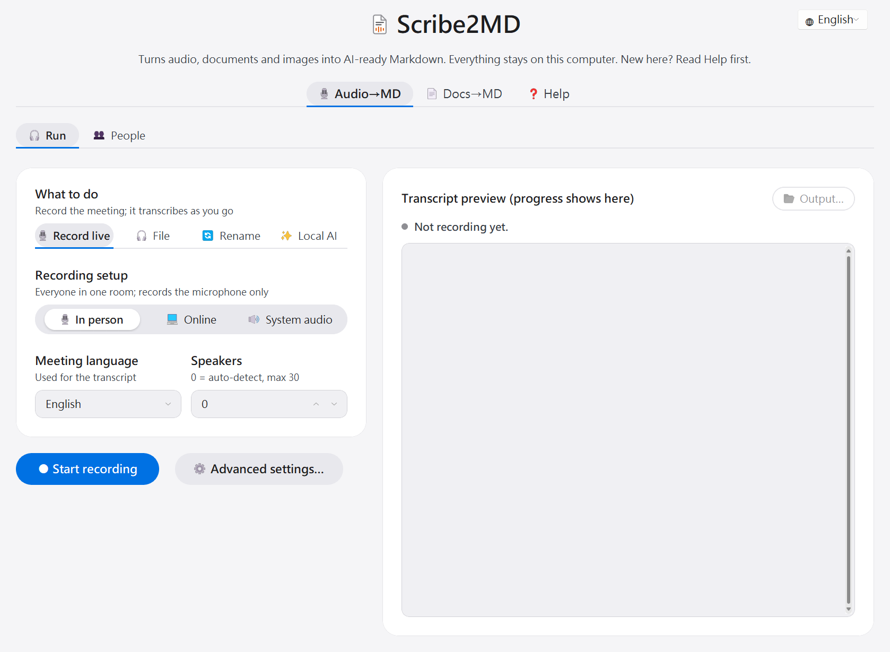
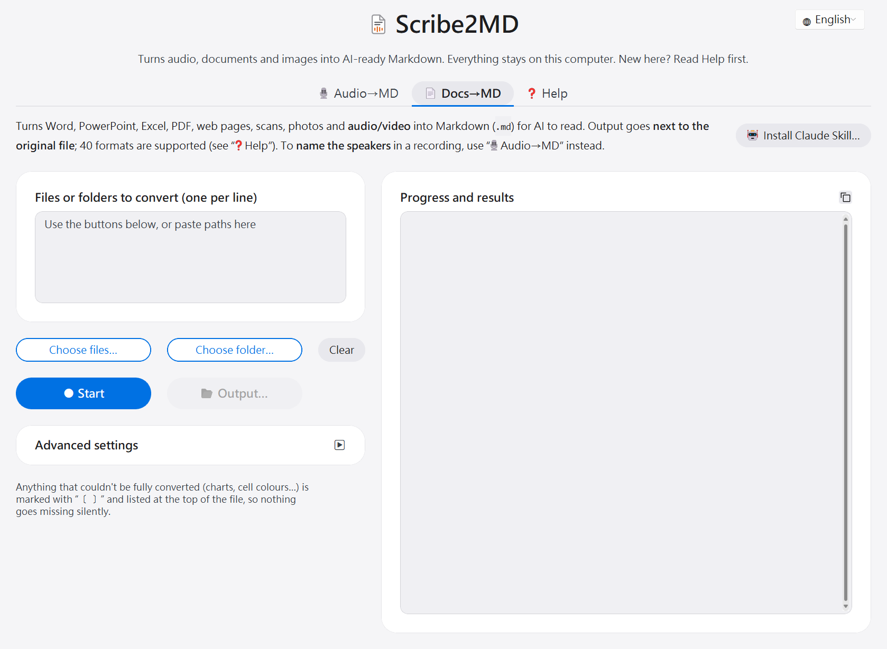

# Scribe2MD User Guide

**English** | [繁體中文](README.zh-TW.md) | [简体中文](README.zh-CN.md)

Turns **audio, documents and images** into **Markdown that AI reads well** (to save tokens): meeting recordings become a “**who said what**” transcript (Traditional Chinese, Simplified Chinese or English), and Word, PowerPoint, Excel, PDF, scans and other documents become Markdown. Everything runs on your own computer: **recordings, documents and transcripts are never uploaded anywhere**. (It goes online in only three cases: downloading the AI models on first use; on Windows, downloading LibreOffice when you convert an **old** Office file and your computer doesn't have it (old means extensions **without a final x**, `doc`/`xls`/`ppt`; today's `docx`/`xlsx`/`pptx` never download anything); and asking GitHub whether there is a new version when it opens, which sends only that one question and can be turned off.)

Supports **Windows 10/11 (x64)** and **Apple Silicon Macs on macOS 14.2 or later** (M1 onwards). ⚠️ Intel Macs are untested and unsupported; Linux is unsupported too. For the differences between the two platforms, see chapter 5, “System requirements”.

📥 **Download (free): [latest version](https://github.com/VincentLiang1/scribe2md/releases/latest)**: open it and pick your platform in the `Assets` section at the bottom: **Windows: `scribe2md-win.zip`, Mac: `scribe2md-mac.zip`**. The files are small on purpose (just over 2 MB for Windows, about 30 MB for Mac, mostly the Python bundled in the App); the runtime and the AI models are downloaded automatically on first start (about 3–6 GB in total, see chapter 5).

> If something goes wrong, check chapter 4, “FAQ and troubleshooting”, first. If that doesn't solve it, contact whoever gave you this tool, or [open an issue](https://github.com/VincentLiang1/scribe2md/issues) on the project's GitHub page.

The interface follows your computer's language (繁體中文 / 简体中文 / English) and can be switched with the “🌐” at the top right of the window. Screenshots and some file names in the tool folder (such as `Install.bat`, “install”) are in Chinese.

---

## Quick start (3-minute version)

In a hurry? This is enough; details follow in the chapters below.

**First installation (once, about 10 minutes)**: the steps below are for Windows; **for a Mac, see “Installing on a Mac” at the end of chapter 1**, which has fewer steps:

1. Unzip the zip to your desktop, or to a folder under `C:\` (for example `C:\Tools`; **folder names in Chinese are fine too**)
2. Double-click **`Install.bat`** (install). If a blue “Windows protected your PC” appears, click “More info” → “Run anyway” (this is normal). A black window installs everything in 3–10 minutes; `環境建置完成` (environment ready) means success. It then **puts a “Scribe2MD” icon on your desktop** (and one in the Start menu); start it from there from now on
3. Double-click “**Scribe2MD**” on the desktop (or **`Launch.vbs`** (start) in the tool folder): the tool's window opens directly, with no browser and no black window

**Everyday use:**

1. Double-click “Scribe2MD” on the desktop (no icon? double-click `Launch.vbs` in the tool folder; it's the same thing)
2. When it opens, “What to do” is set to “**🎙️ Record live**”: choose the recording setup and click “● Start recording” to **record and transcribe while the meeting goes on** (when the meeting ends you only wait for the wrap-up, not a full transcription). See “**🎙️ Record a meeting live**” in the tool's “❓ Help”
3. To transcribe **a file you already have**: switch “What to do” to “**🎧 File**”, click “**Choose files…**” and pick audio (`m4a`/`mp3`/`wav`) or video (`mp4`/`mov`/`avi`), or paste the file path into the box (iPhone Voice Memos are `m4a` and work as they are; **no need to move or copy anything first**, the tool reads the original file in place). Click “Start” (it lights up once a file is chosen) and wait for the progress to finish. **Choosing 1 file** lets you name the speakers; **choosing several files or a whole folder** transcribes them one after another without naming. See “**🎧 Transcribe files**” in the tool's “❓ Help”
4. “Meeting language” and “Speakers” are right on the left column: choose the meeting's language (it defaults to the interface language); **for interviews or conversations with 1–3 people, enter the exact number of speakers**, otherwise (especially meetings of a dozen people) leave it at **0** to auto-detect. Device, model and CPU cores are in “**Advanced settings**” (right of the blue “Start” button in the left column; clicking it opens a small window); the **defaults** are fine
5. Transcripts (`.md` files) are saved in the tool folder's `output`, and “**📂 Output…**” at the top right of the preview opens it. **To see the formatted result, look at the preview on the right of the window**; opened in Notepad or Word you only see raw symbols like `##` and `**`, since Word can't open Markdown
6. To convert **documents** (Word/PowerPoint/Excel/PDF/web pages) to Markdown for an AI: switch to the “**📄 Docs→MD**” tab, choose files or a whole folder and click “Start”. The `.md` files are saved next to the originals. See “**📄 Documents to md**” in the tool's “❓ Help”
7. Close the window when you're done (if it is still recording or converting, the tool asks you first)

**Want to stop half-way?** Click the same button again (while converting it has become “■ Stop”). It changes to “Stopping…” at once and stops once the current piece wraps up, usually within tens of seconds; if a model is loading (progress just started) it may take a minute or two. Click once; no need to click again (it locks once clicked). The half-done file is simply dropped, with no partial output, and the path box clears; to convert something else, just choose again. Closing the window also works (while it's running the tool asks first; nothing gets damaged), and leftover temporary files are cleaned up at the next start.

**Clicked the X at the top right while converting?** A confirmation box stops you first and says what is running (while recording it also tells you how long you've recorded and where the audio file is kept); click “Cancel” to carry on. Closing with nothing running doesn't ask.

**First conversion:** the first “Start” downloads the AI models automatically (about 2–3 GB; each model is downloaded once). **The progress shows the download percentage** (when the window is minimized, the bar under the program icon shows it too). It takes about 10–30 minutes, so please be patient.

---

## 1. First installation (once, about 10 minutes)

### Before you start

- An ordinary Windows 10/11 computer is enough; nothing else needs installing
- You need an internet connection (for installing the runtime and downloading the AI models the first time)

### Step 1: Unzip

Right-click the zip → “Extract All”. You get a `scribe2md` folder containing `Install.bat` (install), `Launch.vbs` (start), this guide (`README.md`) and some program files.

Put it anywhere; **a folder name in Chinese is fine** (tested in Chinese paths: installation, document conversion and transcripts all work). One suggestion: **keep it shallow**: the desktop or under `C:\` (for example `C:\Tools`) is best. Don't bury it in deeply nested folders: paths get close to Windows' length limit and conversions are more likely to run into trouble.

### Step 2: Run Install.bat

Double-click **`Install.bat`**.

- **If a blue “Windows protected your PC” window appears, that's normal** (Windows warns about every batch file that came from the internet). Click **“More info”**, then **“Run anyway”**.
- A **black text window** then installs the runtime automatically, in about 3–10 minutes (depending on your connection).
- When you see **`環境建置完成`** (environment ready), it worked; press any key to close the window.
- If you see `[錯誤]` (error), run it once more; if it still fails, see chapter 4.

### Step 3: Run Launch.vbs

Double-click **`Launch.vbs`**.

- **The tool's window opens directly** (in about a second), with no browser and no black text window.
- Double-clicking again while one is already open brings that window to the front instead of opening another.
- If nothing happens at all, the installation usually didn't finish or the folder wasn't copied completely: run `Install.bat` again (the launcher detects this itself and explains).

From then on, double-click the desktop icon (or `Launch.vbs`) whenever you want to use it.

### Installing on a Mac

1. On the download page, click **`scribe2md-mac.zip`** under `Assets` and double-click to unzip it; you get the App “**AI 文件.MD 轉換器**” (Scribe2MD). Dragging it into “**Applications**” makes it easier to open from Launchpad or the Dock (double-clicking it in “Downloads” works too).
2. **Double-click it.** macOS may first ask whether to open an App downloaded from the internet; choose “Open” (the App is notarized by Apple, so it only asks the first time).
3. A **Terminal window** then builds the runtime automatically (first installing uv, a Python environment manager, then downloading dependencies), in about 3–10 minutes. When you see “**完成。正在啟動……**” (done, starting…) the tool's window opens by itself; the Terminal window **doesn't close by itself**: when it stops at “`[Process completed]`” it is finished and you can close it. If you see `[錯誤]` (error), check the network and double-click the App again.
4. From then on it opens directly with a double-click, **with no Terminal** (it appears once more only after an update).

More things to know on a Mac:

- **The first time you record, macOS asks whether the App may use the microphone**; choose “Allow”.
- **To record what the computer plays** (the “Online” and “System audio” setups): turn the App on in “System Settings › Privacy & Security › Screen & System Audio Recording”, **then quit and reopen the tool**.
- **Transcripts aren't next to the App**: the App itself is read-only, so `output` (transcripts and recordings), `data` (voiceprints and the people list) and the logs are in `~/Library/Application Support/meeting-scribe/app/`, and `Library` is hidden in Finder by default. The tool's “**📂 Output…**” button is the quickest way in; other ways are in “❓ Help”.
- **Don't close the lid while recording**: once a Mac sleeps, the audio device stops, and that stretch of sound can't be recovered (the screen dimming or turning off by itself is fine).
- **On macOS 26 or later, the Mac's built-in speech recognition (model “Apple”) is the default**: the first time, if this Mac doesn't have the speech data for the meeting language yet, macOS downloads it itself (that one time only). For meetings full of English technical terms and numbers, choose “Fast” or “Accurate” in “Advanced settings”.
- **To let Claude Code run conversions itself**: in the tool's “📄 Docs→MD” tab, click “🤖 Install Claude Skill…” at the top right. Or double-click “`Install-Skill.command`” in the tool folder above (`~/Library/Application Support/meeting-scribe/app/`). If you use Terminal, you can also paste this line: `cd ~/Library/Application\ Support/meeting-scribe/app && uv run python scripts/install_skill.py`.

---

## 2. Everyday use

### The tabs in the window

| Tab | What it does |
| --- | --- |
| 🎙️ Audio→MD | Meeting recordings or live recording → transcript. It has two sub-tabs: “**🎧 Run**” (where you usually are) and “**👥 People**” (the people list and remembered voiceprints used for naming speakers) |
| 📄 Docs→MD | Word / PowerPoint / Excel / PDF / web pages / scans / photos / email → Markdown |
| ❓ Help | **The full explanation of every feature**, in ten sections organized by “what you want to do now” |

Double-click the desktop icon and the tool's window opens. “What to do” starts at “**🎙️ Record live**” (how and why: “🎙️ Record a meeting live” in Help); to transcribe a file you already have, switch “What to do” to “**🎧 File**” (see “🎧 Transcribe files” in Help).

### 📋 Features at a glance

**This only lists “what features there are”, so you know what it can do; for details on each, see the tool's “❓ Help” tab** (its table of contents on the left is organized exactly like the list below; click a section to open it).

**🚀 Before you start**

- The first conversion downloads the AI models automatically (about 2–3 GB, once only)
- The output is always `.md` (a conversational transcript, punctuated automatically)
- Dark/light follows your system setting
- Everything is processed on your computer; no files leave it
- Your things (transcripts in `output`, voiceprints, people list and word lists in `data`) are all in the tool folder; copying it is your backup
- “📂 Log…” at the top right of “❓ Help” opens this session's log in one click (attach it when reporting a problem)
- The interface is in 繁體中文 / 简体中文 / English (follows your computer; “🌐” at the top right switches it)
- **Automatic update check**: when it opens and a new version exists, it asks whether to update; on Windows “Update now” swaps itself and reopens (on a Mac it gives you the download page); tick “Don't remind me”, or click “🔄 Check for updates” at the very bottom of “❓ Help”

**🎙️ Record a meeting live (live recording)**

- Three recording setups: in person, online (**echo removed automatically**, speakers are fine, no headset needed), system audio only; **it always starts at “In person”**
- Transcribes while the meeting goes on, so there is almost no wait afterwards; with a graphics chip even speaker separation is done during the recording
- The audio file is a result too (`錄音_date_time.wav`; online meetings are stereo: left = room, right = computer)
- “‖ Pause” / “● Resume”: nothing is recorded while paused and it isn't counted in the transcript's time; the seam is marked 〔Recording paused here…〕
- “★ Highlight” (or ⌘B/Ctrl+B): press it when you hear something important, and type a note on the spot if you like; the transcript marks it 〔highlight〕 with the note under that turn (same format as the phone app), and the minutes draft gets a section for them
- Closing the window while recording asks first; the computer doesn't sleep while recording
- “Speakers” can be changed at any time while recording
- “Meeting language”: Traditional Chinese / Simplified Chinese / English (for files too); the transcript is recognized and written in it, in the same format as the phone app

**🎧 Transcribe files**

- Choose files (several at once), a whole folder, or paste a path: **no need to move or copy anything first**
- 1 file → name the speakers when it's done; several files or a folder → transcribed one after another, no naming
- “Include subfolders” is optional (off by default)
- You can stop at any time while converting; finished files are kept; on failure the path stays so you can retry

**👥 Name the speakers**

- Recognizes people registered before and **fills in their names**; it gets more accurate the more you use it
- Each field shows “number of turns + longest sentence”, and “▶ Play” plays that speaker's audio
- A name goes to only one speaker per meeting; when unsure it **leaves the field blank instead of guessing**
- The end of the transcript carries “**Speaker diagnostics**”, pointing out the labels most worth checking by hand
- “**🔍 Check**”: play one speaker's turns back to back, and move any turns that turn out to be someone else (in live recording, file transcription and Rename alike)
- The “Unknown” row only changes the transcript text and doesn't register voiceprints
- Maintain the people list, delete voiceprints one by one or all at once, rename a person in both list and voiceprints together (merging two names asks first)
- **Share voiceprints and the people list between phone, Windows and Mac**: choose the same OneDrive folder on each and they sync
- **Voiceprint check-up**: finds someone else's voiceprint mixed under a name; it also warns when the list and the voiceprint store don't match
- Naming progress is saved on the computer, so you can close the tool and carry on the next day
- **Rename**: name speakers afterwards, or fix a mistyped name, without transcribing again

**📄 Documents to md**

- Supports Office (including old and macro formats), OpenDocument, PDF, images, csv/txt/rtf, web pages and e-books, Visio, Outlook email, audio and video
- **Text in images is recognized automatically (OCR)**, including images embedded in documents
- Simplified Chinese is converted to Traditional, hyperlinks keep their URLs, Word footnotes go to the end, photos get their shooting details
- Email attachments are converted recursively (nested messages up to 3 levels)
- What can't be converted is marked “〔 〕” in place and summarized at the top of the file; **nothing is ever dropped silently**
- If an `.md` with the same name exists it is skipped, so the same folder can safely be run again
- Results are saved next to the original documents; “📂 Output…” jumps right there

**🤖 Hand it to an AI**

- Before pasting to an AI, turn off the setting that “trains models on your conversations” (with a screenshot of the setting)
- **Meeting minutes draft**: a local AI on this computer turns the transcript into a summary, main topics and action items (with approximate times), and the transcript never leaves this computer (Windows uses the tool's built-in model, about 2–3.4 GB downloaded on first use; on a Mac each meeting can use Apple Intelligence, or the built-in Qwen 4B, which is more complete, downloads about 3 GB on first use and needs 16 GB of memory or more); the draft is written in the transcript's language. ⚠️ **A small local model is limited and not as good as cloud AI**, so treat it as a draft and work from the transcript for official minutes; drafts are kept in the tool's own folder, not next to the transcript

**⚙️ Accuracy and speed**

- Model “Fast / Accurate” (Accurate by default when Windows detects a usable graphics chip; Fast otherwise); **Macs on macOS 26 or later have an extra “Apple” option, used by default**: the Mac's built-in speech recognition, about 1 minute for a 2-hour meeting, at the cost of weaker technical terms and numbers and ignoring the terms list
- Meeting language (Traditional Chinese / Simplified Chinese / English; defaults to the interface language)
- Number of speakers (0 = auto-detect)
- **Terms**: fewer misspelled proper nouns in Traditional Chinese meetings (no tab on screen; edit `data/hotwords.txt` in Notepad)
- CPU cores; during conversions it drops to background priority, so the computer stays usable
- **Device** “Auto / CPU only”: when an old computer's graphics chip is slower than its CPU, you can turn it off by hand (this setting is remembered)

**⚡ Automation, batches**

- The `doc2md` command line, without opening the tool's window (**all options** are in that section's table)
- “🤖 Install Claude Skill…” in the “📄 Docs→MD” tab (or double-click `Install-Skill.bat`, on a Mac `Install-Skill.command`): lets AI tools such as Claude Code run conversions themselves
- `audit_voiceprints.py`: a full check of the voiceprint store (more detailed than “Check-up” in the tool)

**🆘 Something seems off**

- A button that doesn't respond (usually another job is running), how to tell it's still running when minimized, 99% CPU is normal, a folder window that only flashes in the taskbar, recording data discontinuous, how to retry a failed conversion, deleting the old `.md` to redo a file, which log file to attach when reporting a problem

**💡 Why this tool exists**

- What problem this tool set out to solve, how it grew into what it is now, and what became visible once it was built (the one section that isn't about how to use it)

### Where the details are

The **full explanation** of everything above is in the tool's “**❓ Help**” tab: it's right there when the tool opens, its table of contents on the left is organized exactly like the list above, and you click the section you want.

**Why the details aren't here**: two copies of the same explanation will sooner or later drift apart, and which one a user reads is pure luck. The one in the tool is closest to the work (the buttons are right next to it), so that is where the details live; this README covers “**what to know before starting the program**”: how to install it, what it can do, and what to do when something goes wrong.

> Only want the **command line**, without the tool's window? `uv run doc2md --help` prints every option; the full explanation is in Help's “⚡ Automation, batches”.
---

## 3. Getting recordings onto the computer

- **iPhone Voice Memos**: open “Voice Memos” → tap the recording → Share (the up-arrow icon) → **email it to yourself**, send it to **your own chat in LINE/Teams**, or save it to **OneDrive**, then download it on the computer. You get an `.m4a` file; pick it with “Choose files…”.
- **Teams meeting recordings**: after the meeting, the recording appears in that meeting's chat → click the recording → “…” at the top right → **Download**, and you get an `.mp4` file.

---

## 4. FAQ and troubleshooting

**Q: Double-clicking the .bat shows a blue “Windows protected your PC”?** That's normal. Click “More info” → “Run anyway”.

**Q: Can't find the “Start” button, or it's grey and can't be clicked?** If the button isn't there at all, “What to do” is on “Record live” (the default when it opens): switch to “**🎧 File**” and it appears. If it's there but grey, no file is chosen yet (or a file just finished and the path box was cleared, waiting for the next): click “Choose files…”, pick a file, and the button lights up.

**Q: After clicking start, progress sits at “transcription and speaker analysis” for a long time?** If it's the **first conversion** (or the first time using the “Accurate” model), it's downloading the AI models (about 2–3 GB); the progress line shows the percentage, so just wait for it (10–30 minutes). Otherwise, long recordings simply take time: about 20–40 minutes for a one-hour meeting. When the window is minimized, the bar under the program icon shows it's still running.

**Q: The conversion failed saying the model download failed and to check the connection and retry?** The first use (or the first time using “Accurate”) needs the internet to download the AI models, and this message means the download didn't succeed. Once the network is fine, click “Start” again; downloads resume, so it doesn't start over. If it keeps failing on a company or school network, a firewall or proxy may be blocking the download; another network (home, a phone hotspot) usually works. If not, contact whoever gave you the tool.

**Q: It says it doesn't trust the download site's security certificate, or the log shows a long `CERTIFICATE_VERIFY_FAILED`?** This computer can't verify the download site's certificate, so the AI models can't be downloaded. **The network itself is fine** (the same address opens in a browser), so checking the network won't find anything. Most common on company networks that inspect connections, or when Windows is missing root certificates. The tool tries two fixes automatically; if it still fails, pass this on to your IT department: the company's root certificate needs to be imported into Windows' “**Trusted Root Certification Authorities**”. Another way is to ask a colleague whose tool works to copy their models folder (`%LOCALAPPDATA%\meeting-scribe\models`) to the same place on your computer; the models then work in place, with no download. By the way, **an audio file being there but no play button when renaming speakers** is the same thing (the voiceprint model couldn't be downloaded, so that time only manual naming was possible). To give the details to whoever gave you the tool: type `cmd` in the address bar of the tool folder in File Explorer, run `uv run python scripts\diagnose_tls.py`, and copy the whole output to them (it only checks; it downloads nothing and changes no settings).

**Q: Right after opening the tool: “this computer is missing system components the AI needs”?** This Windows is missing a system component the AI models use, the **Microsoft Visual C++ 2015-2022 Redistributable (x64)**; see chapter 5, “System requirements”. That notice has a “**📋 Copy download link**” button on its right that puts Microsoft's official download address on the clipboard; paste it into a browser to download. After installing, restart the tool and it works. ⚠️ **Audio already recorded isn't lost**: the file is still in `output`; once the component is installed, switch to “**🎧 File**” and transcribe it again to get the transcript, with no need to hold the meeting again.

**Q: Nothing appears after double-clicking?** First check that `Install.bat` finished (you saw `環境建置完成`). The launcher itself catches “the folder wasn't copied completely” and “the environment isn't built yet” and shows a message; if there's no message at all, look at the newest log in the tool folder's `logs` subfolder and attach it to your report.

**Q: A button doesn't respond?** Recording, transcription and document conversion **can only run one at a time**; the other two “Start” buttons are blocked (the screen says which side is busy). While a job runs, “Advanced settings” and the “People” tab are locked too, since settings are fixed the moment you click start. Everything comes back when it finishes or you click “Stop”.

**Q: Install.bat shows [錯誤] (error)?**
1. Check the network and run it again (it doesn't start over; finished parts are kept).
2. If it keeps failing on a company or school network, a firewall or proxy may be blocking downloads; another network (home, a phone hotspot) usually works. If not, contact whoever gave you the tool.

**Q: Antivirus warns or quarantines files?** Every component of this tool is open source, with no malicious behavior (the source code is public for you to inspect). Add the tool folder to your antivirus allow list; on computers where you can't change that yourself (such as company-issued ones), contact your IT department.

**Q: What does “(此段轉錄異常……請對照原始錄音)” (transcription of this part failed, check the original recording) in a transcript mean?** When several people talk at once, there is a lot of noise, or someone talks at length without pausing, the AI transcription model occasionally gets “stuck”, repeating the same word endlessly (“including data, including data, …”), and the real content of that part can't be transcribed. The tool detects this and retries automatically; parts it still can't recover are honestly marked “not reliable” with this note and the time range, so you can go straight to that part of the recording. It usually affects only one passage; the rest of the transcript is fine.

**Q: Will it send my recordings anywhere?** No. The tool is a window program running on your own computer, with all outgoing telemetry off. Its network activity is downloading the models and runtime the first time, and asking GitHub whether there's a new version when it opens (only that one question, with no files or usage data; it can be turned off at the bottom of “❓ Help”). Once the models are downloaded, conversions are **entirely offline** (it works with the network cable unplugged). Recordings and transcripts stay on your computer from start to finish.

**Q: Do converted files stay in the computer's temporary folder?** Conversions create working copies (intermediate files) in the system's temporary folder; **they are cleaned up immediately when the tool closes normally, and leftovers from a crash are cleaned up the next time it starts**, so they don't pile up. Your **original files are never affected** (the tool only reads them; it never moves or deletes them). Finished transcripts and recordings are kept permanently in `output`; they aren't temporary.

**Q: How much does it download the first time?** A few hundred MB of runtime (`Install.bat`) + about 2–3 GB of AI model + about 60 MB of punctuation model + about 50 MB of conversion tools (at the first conversion). Each is downloaded once. “Fast” and “Accurate” each use their own model, downloaded the first time it's used; with both, the models total about 4–6 GB.

**Q: How fast is it?** Newer computers (for example an Intel Core Ultra 7 with Arc integrated graphics) automatically use the built-in GPU to speed up transcription while the CPU does speaker analysis, both at once without waiting for each other. On computers without a usable graphics chip, the two steps run one after the other (so they don't fight over the processor), and being slower is normal. With the Fast model, a one-hour meeting takes roughly 20–40 minutes. **On computers with a GPU, “Accurate” and “Fast” take about the same total time**: speaker analysis (CPU) is the bottleneck and runs alongside transcription, so Accurate's extra transcription time is hidden inside it. That's why such machines default to Accurate (at the cost of about 3× as much work for the graphics card and more power); only on computers without a GPU is Accurate clearly slower, about 4×. Processing time is roughly proportional to the recording's **length** (a 3-hour recording takes about 1–2 hours), not its file size, so large files of hundreds of MB are nothing to worry about. You can leave the window alone and do something else meanwhile. To see whether your GPU was detected, click “**Advanced settings**” to the right of the blue “Start” button in the left column; the line under “Model” says so (“GPU: …” or “CPU: …”). To see **which kind** (Intel GPU / NVIDIA GPU / CPU), look at “This computer will use” in “❓ Help” → “⚙️ Accuracy and speed”. The start of the transcript preview also shows the device actually used. And: during long stretches of talk without any pause, the progress bar may stand still for a while and then jump forward; that's not a hang.

One known exception to watch for: **the integrated graphics of some older computers (such as the Intel UHD 600 series) are also treated as accelerators automatically, but they're too weak and may actually be slower than the CPU alone, and the tool doesn't notice “too slow” and switch back to the CPU** (it only sees whether there is one, not how strong). How to tell: “This computer will use” in “❓ Help” → “⚙️ Accuracy and speed” says “Intel GPU” (after one conversion, the start of the transcript preview says so too), progress really is moving and it isn't downloading a model, yet it's unreasonably slow. **In that case you can turn it off yourself**: click “**Advanced settings**” → set “**Device**” to “**CPU only**”, and convert the same file again to compare (this setting is remembered). ⚠️ Once off, transcription and speaker analysis go from “at the same time” to “taking turns”, so **it isn't guaranteed to be faster**; it only pays off when that graphics chip really is slower than the CPU, and converting the same file both ways is the only way to find out.

**Q: Can I use the tool on another computer?** Yes. Copy the zip to the other computer and install it again with the three steps in chapter 1 (unzip → `Install.bat` → `Launch.vbs`); nothing needs changing. Three things to know:

1. **Each computer downloads the models again**: the AI models are stored in each computer's, each user account's own user folder, **not in the tool folder**, so copying the tool folder doesn't bring the models along. The new computer downloads about 2–3 GB again at its first conversion (different accounts on the same computer each download their own, too).
2. **Same system requirements**: see chapter 5. Moving from Windows to a Mac (or back) works too, but download **that platform's zip** and install again; to bring voiceprints and the people list along, copy the old computer's whole `data` folder to the same place on the new one (for the Mac location, see the end of chapter 1).
3. **Speed varies a lot between machines**: older computers without a graphics chip work, just more slowly; for speed expectations and the special note on old integrated graphics, see “How fast is it?” above.

**Q: Speakers aren't separated well?** First see which kind of meeting it is; the two call for **opposite** approaches:

- **Interviews or conversations with 1–3 people** → enter **the exact number** in “Speakers”. This is exactly the size auto-detect is worst at: a tested 95-minute conversation between two people left at 0 still got an extra speaker (it used to be 16). When there are few people and you can count them, entering the number is much more stable.
- **One person talking most of the time** (a talk, a class) → **leave 0**. The main speaker may be split into two (long stretches vs. short answers in Q&A); give both their name.
- **Meetings of more than a dozen people** → **leave 0 and let it decide; don't force a number**. With many people you can't really count them, and in the same tested meeting of 20-plus people, auto-detect separated the four remote connections, while 18/22/25/30 each merged them into one: when you set the number, the slots get taken by noise fragments of a few seconds.
- **In between** → leave 0; entering the number is fine if you're sure.

With 0, the tool keeps speakers who talk enough and sound clearly different from the others, merging only “very short noise fragments” and “drift from one person's volume or distance changing”. Recording quality (distance from the microphone, background noise) affects the result directly too, and matters more than any setting. Also, the “Speaker diagnostics” section at the end of the transcript lists each label's turns, time and cohesion, and names the few most worth checking first; to judge whether a transcript was separated well, looking there is much faster than listening to it all again.

**Q: How do I update to a new version?** **On Windows you usually don't need to do anything**: when a new version exists, a window appears as the tool opens; “Update now” downloads it, swaps it in and reopens by itself (you can also click “🔄 Check for updates” at the very bottom of “❓ Help”). Only when the automatic update can't run (a Mac, or no write permission on the tool folder) do it by hand: download the latest version from the [Releases page](https://github.com/VincentLiang1/scribe2md/releases/latest) (that address always points to the latest version, so there's nothing to pick). **Windows**: download `scribe2md-win.zip` (called `scribe2md.zip` up to v0.9.20, same content), unzip it **over** your current tool folder (when File Explorer asks whether to replace, choose replace), then double-click `Install.bat` once more; it's the same zip as the first installation. **Mac**: download `scribe2md-mac.zip`, let the unzipped App **replace** the old one, then double-click it; the first time it opens, a Terminal window updates the runtime and then the tool opens by itself.

**Everything you had is kept**: transcripts in `output`, voiceprints, the people list and word lists in `data`, and the AI models already downloaded (stored in `%LOCALAPPDATA%\meeting-scribe\models` on Windows and `~/Library/Application Support/meeting-scribe/models` on a Mac, not in the tool folder, so updates can't touch them). `data-default` in the tool folder is the factory default, only used to fill in what's missing from `data`; it never touches your data.

To be extra safe, copy the `data` folder somewhere else before updating; it takes two minutes.

**Q: Not enough disk space; can I delete the models?** On Windows, delete the `%LOCALAPPDATA%\meeting-scribe\models` folder (paste that path into File Explorer's address bar to open it); on a Mac, delete `~/Library/Application Support/meeting-scribe/models` (Finder → “Go” → “Go to Folder…”, paste the path). They're downloaded again the next time you use it.

**Q: What should I include when reporting a problem?** Switch to the “❓ Help” tab and click “📂 Log…” at the **top right**; the file manager points straight at this session's log (one per start, named by the start time, for example `2026-08-03_143020-12345.log`; no need to dig through the tool folder). **Attach that file to your report** (to whoever gave you the tool, or in a GitHub issue): it holds diagnostics not shown on screen (such as whether audio capture was stable during a recording), which is far more useful than a description. The log's first lines include “**程式版本**” (program version), so attaching the file covers it; without it, nobody knows which version you have. Logs stay on your own computer, are never sent anywhere, and are deleted automatically after 30 days.

---

## 5. System requirements

**Both platforms**:

- 8 GB of memory or more (16 GB recommended; 32 GB is plenty)
- Disk space: about 8 GB (runtime + models; add 2–3 GB if you download both the “Fast” and “Accurate” models)
- An internet connection for the first installation and the AI model downloads; conversions are entirely offline after that (checking for and installing updates connects to GitHub)
- **No need** to install Python or ffmpeg beforehand; installation handles it all

**Windows**:

- **Windows 10/11 (x64)**
- To convert **old** Office files (extensions **without a final x**, `doc`/`ppt`/`xls`; `docx`/`pptx`/`xlsx` don't need it) on a computer without LibreOffice, the tool downloads it automatically, using about 1 GB more
- **Microsoft Visual C++ 2015-2022 Redistributable (x64)**: retail Windows and company-issued laptops almost always have it already, so nothing to do; **virtual machines, freshly reinstalled or stripped-down Windows** often don't. Without it the tool opens, but the first conversion says “the AI components can't be loaded on this computer”; install the x64 version from [Microsoft's official download page](https://learn.microsoft.com/cpp/windows/latest-supported-vc-redist) and restart the tool

**Mac**:

- **macOS 14.2 or later, Apple Silicon (M1 or later)**. ⚠️ Intel Macs are untested and unsupported
- **AI runs on the CPU only** (there's no GPU acceleration the tool can use on a Mac), so while recording the tool switches to the “Fast” model and fewer cores to keep up analysing as it records; transcribing existing files uses what you chose
- **Old Office files (`doc`/`ppt`/`xls`), OpenDocument and Visio need LibreOffice installed by yourself** (put it in “Applications”): on a Mac the tool only looks for it and doesn't download it. No other format needs it
- Recording what the computer plays needs the “Screen & System Audio Recording” permission first; see “Installing on a Mac” at the end of chapter 1

**Linux is not supported.**

## 6. License

This tool is released under **AGPL-3.0**; the full terms are in `LICENSE` in the tool folder. ⚠️ **The `winkit\` subfolder is MIT** (its license is in `winkit\LICENSE`): it's the shared layer for windows, skins and shortcuts, shipped with this tool under a different license, so using it for other things isn't bound by the AGPL. In plain words: you may use, copy and modify it freely; only when you **distribute a modified version** must you provide its source code under the same license. Using it yourself to convert files, or inside your organization, has no restrictions.

License inventory of the components:

| Component | License |
|------|------|
| Whisper models (OpenAI) / faster-whisper / CTranslate2 | MIT |
| sherpa-onnx / 3D-Speaker embedding / OpenCC / OpenVINO | Apache-2.0 |
| winkit (shared layer for windows, skins and shortcuts; the `winkit\` subfolder) / sv-ttk (theme) | MIT |
| FunASR CT-Transformer punctuation model (converted by sherpa-onnx) | Apache-2.0 |
| pyannote segmentation-3.0 (ONNX conversion) | MIT |
| FFmpeg (via static-ffmpeg, called as an external program) | LGPL/GPL (not distributed with this tool; your computer obtains it at installation) |
| python-docx / python-pptx / openpyxl / markdownify / beautifulsoup4 (documents to Markdown) | MIT |
| lxml / striprtf / charset-normalizer (documents to Markdown) | BSD |
| oletools / olefile (reading the outline of Excel macros) | BSD |
| RapidOCR + PP-OCRv6 models (text recognition in images) | Apache-2.0 |
| Qwen3.5-4B / 2B language models (Alibaba Tongyi Qianwen; for the “✨ Local AI” minutes draft: on Windows the OpenVINO int4 version converted by Intel, on a Mac the MLX 4-bit version converted by mlx-community; not distributed with this tool, downloaded on first use) | Apache-2.0 |
| MLX / mlx-lm (the inference framework for Qwen 4B on a Mac; installed only on Apple silicon Macs) | MIT |
| transformers / sentencepiece / safetensors (used by mlx-lm to read the model) | Apache-2.0 |
| pillow-heif (HEIC decoding; includes libheif) | BSD-3 / LGPL (dynamically linked) |
| extract-msg (Outlook email) | BSD-2 |
| LibreOffice (old Office format conversion, called as an external program) | MPL-2.0 |
| **PyMuPDF (PDF parsing)** | **AGPL-3.0**, see below |

**Why the whole tool is AGPL:** it wasn't a choice; it comes from PyMuPDF, used for PDF parsing. The AGPL requires “providing the source code when distributing the software”, and it is **copyleft**: distributing a work that uses it means the whole work must be released under a compatible license. This tool ships as plain `.py` source (not a compiled executable), so “including the source” is satisfied by nature. The only alternative is the BSD-licensed `pypdfium2`, at the cost of worse table and layout recovery, and this tool's output is mainly for AI to read, where a broken table structure ruins the whole passage, so the AGPL stays.
