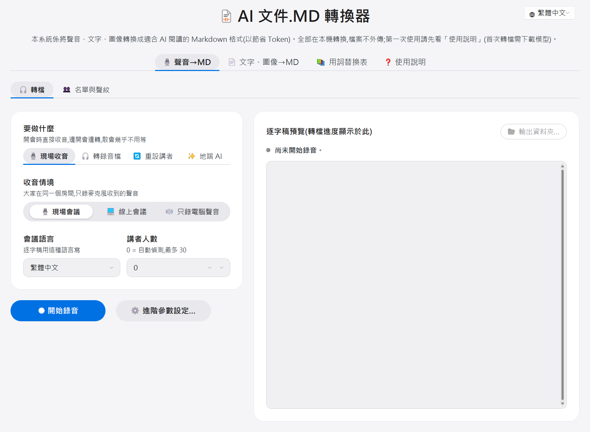
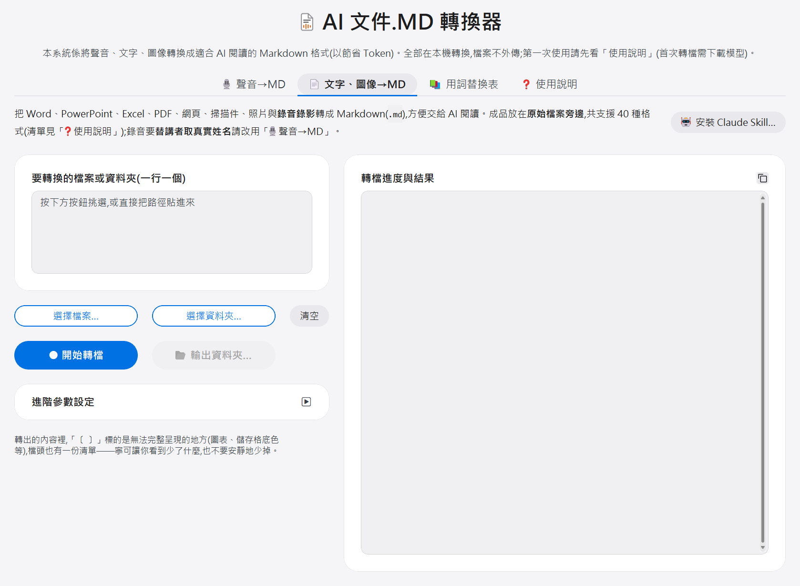

# AI 文件.MD 轉換器 使用手册

[繁體中文](README.md) | [English](README.en.md) | **简体中文**

把**声音、文字、图像**都转换成**适合 AI 阅读的 Markdown 格式**(以节省 Token):会议录音或录像变成「**谁说了什么**」的**逐字稿**(繁体中文、简体中文或英文),Word、PowerPoint、Excel、PDF、扫描件等文档转成 Markdown。所有处理都在本机电脑完成,**录音文件、文档和逐字稿都不会上传到任何地方**。(只有三种情况会连网:第一次使用时下载 AI 模型;在 Windows 上转**旧版** Office 档而电脑上没有 LibreOffice 时下载它——旧版指扩展名**结尾没有 x** 的 `doc`/`xls`/`ppt`,现在的 `docx`/`xlsx`/`pptx` 不会下载任何东西;以及打开时向 GitHub 问有没有新版——只发送这一个询问,可以关掉。)

支持 **Windows 10/11(x64)** 与 **macOS 14.2 以上的 Apple Silicon Mac**(M1 之后的机型)。⚠️ Intel 芯片的 Mac 没有测试过、不支持;Linux 也不支持。两个平台的差异见第五章「系统需求」。

📥 **下载(免费):[最新版](https://github.com/VincentLiang1/scribe2md/releases/latest)** —— 点进去,在页面下方的 `Assets` 区块挑你的平台:**Windows 点 `scribe2md-win.zip`、Mac 点 `scribe2md-mac.zip`**。文件不大是正常的(Windows 版 2MB 出头、Mac 版约 30MB,多的是 App 内附的 Python),运行环境与 AI 模型都是第一次启动时才自动下载(合计约 3～6GB,见第五章)。

> 有问题先看第四章「常见问题与故障排除」;还是解决不了,就联系把这个工具给你的人,或到项目的 GitHub 页面[开一个 issue](https://github.com/VincentLiang1/scribe2md/issues)。

---

## 快速上手(3 分钟版)

赶时间先看这段就够了,细节在后面各章。

**第一次安装(只做一次,约 10 分钟)**——以下是 Windows;**Mac 看第一章最后的「Mac 的安装」**,步骤更少:

1. 解压缩 zip 到桌面,或 `C:\` 下的文件夹(例如 `C:\Tools`;**文件夹名称用中文也可以**)
2. 双击 **`Install.bat`**——若跳出蓝色「Windows 已保护您的电脑」,点「其他信息」→「仍要运行」(这是正常的);黑色窗口自动安装 3～10 分钟,看到 `環境建置完成` 就是成功。装完会**在桌面放上「AI 文件.MD 轉換器」的图标**(「开始功能表」里也有一份),以后从那里启动就好
3. 双击桌面上的「**AI 文件.MD 轉換器**」(或工具文件夹里的 **`Launch.vbs`**)——工具窗口会直接开起来,不需要浏览器,也没有黑色窗口

**日常使用:**

1. 双击桌面上的「AI 文件.MD 轉換器」(没有那颗图标就双击工具文件夹里的 `Launch.vbs`,两者完全一样)
2. 打开时「要做什么」默认就是「**🎙️ 现场收音**」——选好收音情境,按「● 开始录音」就能**边开会边录边转**(会议结束只等收尾,不用整场重转),详见工具里「❓ 使用说明」的「**🎙️ 开会时直接录音**」
3. 要转**已经录好的文件**:把「要做什么」切到「**🎧 转录音文件**」,按「**选择文件…**」挑选录音(`m4a`/`mp3`/`wav`)或录像(`mp4`/`mov`/`avi`)——也可以直接把文件路径贴进输入框(iPhone 语音备忘录的文件就是 `m4a`,直接可用;**不必先搬动或拷贝**,工具直接读电脑里的原档),按「开始转换」(选好文件后按钮才会亮起),等进度跑完。**选 1 个文件**才会让你替讲者命名;**选多个文件或整个文件夹**是整批连续转、不做命名,详见工具里「❓ 使用说明」的「**🎧 转现成的录音、录像**」
4. 「讲者人数」就在左栏主画面上:**1~3 人的访谈或对谈请填确切人数**,其余(尤其十几人的会议)留 **0** 让它自动判断。运算设备、模型与 CPU 内核数都收在「**高级参数设置**」里(左栏蓝色「开始」按钮的右边,点一下会开一个小窗口),用**默认值**就好
5. 逐字稿(`.md` 档)存在工具文件夹的 `output` 里,按预览区右上角的「**📂 输出文件夹…**」就直接开到那里;**排版好的样子看窗口右侧的预览区**,用记事本或 Word 打开只会看到 `##`、`**` 这些原始符号——Word 没有打开 Markdown 的功能
6. 要把**文档**(Word/PowerPoint/Excel/PDF/网页)转成 Markdown 给 AI 读:切到「**📄 文字、图像→MD**」分页,选文件或整个文件夹,按「开始转换」——转好的 `.md` 就放在原始文档旁边,详见工具里「❓ 使用说明」的「**📄 文档、图片转成 md**」
7. 用完关掉窗口即可(还在录音或转换时,工具会先问你一次)

**转到一半不想转了?** 再按一次同一颗钮(转换中它已经变成「■ 停止转换」),字会立刻换成「停止中…」,等目前片段收尾后停下——一般几十秒内,若正在加载模型(进度条刚起步时)可能要一两分钟,按一次就好、不用重按(按过就会锁住)。转到一半的文件直接放弃、不留半成品,路径栏也会清空——要转别的文件,重新选档即可。直接关窗口也可以(还在跑的时候工具会先问你一次;不会弄坏任何东西),残留的暂存盘会在下次启动时自动清掉。

**转换中不小心按到窗口右上角的 X?** 会先跳出确认框挡一下,并讲清楚正在跑的是哪一件事(录音中还会告诉你已经录了多久,以及声音频文件会留在哪里),按「取消」就能继续。没有工作在跑时关闭则不会多问。

**第一次转换特别注意:** 第一次按「开始转换」会先自动下载 AI 模型(约 2～3GB,同一个模型只下载一次)。**画面上的进度会显示下载到几 %**(把窗口缩到任务栏时,程序图标底下那条进度也看得到),约 10～30 分钟,请耐心等待。

---

## 一、第一次安装(只需做一次,约 10 分钟)

### 事前确认

- 一般的 Windows 10/11 电脑即可,不需要另外安装任何软件
- 需要网络(安装环境与第一次下载 AI 模型会用到)

### 步骤 1:解压缩

对 zip 档按右键 →「全部解压缩」。解压后会得到一个 `scribe2md` 文件夹,里面有 `Install.bat`、`Launch.vbs`、这份使用手册(`README.md`)和一些程序文件。

放哪里都可以,**文件夹名称是中文也没关系**(工具在中文路径下实测过:安装、文档转换、逐字稿都正常)。只有一个建议:**放浅一点**——桌面或 `C:\` 底下(例如 `C:\Tools`)就好,别塞进层层嵌套的深文件夹里,那会让路径长到接近 Windows 的长度上限,转换时比较容易出状况。

### 步骤 2:运行 Install.bat

双击 **`Install.bat`**。

- **如果跳出蓝色的「Windows 已保护您的电脑」窗口:这是正常的**(Windows 对来路是网络的批量档一律警告)。点 **「其他信息」**,再点 **「仍要运行」** 即可。
- 接着会出现一个**黑色文字窗口**,自动安装运行环境,约需 3～10 分钟(视网络速度)。
- 看到 **`環境建置完成`** 字样就是成功了,按任意键关闭窗口。
- 如果看到 `[錯誤]`,先重跑一次;仍失败请看第四章。

### 步骤 3:运行 Launch.vbs

双击 **`Launch.vbs`**。

- **工具窗口会直接开起来**(约一秒),不需要浏览器,也不会有黑色文字窗口。
- 已经开着一个的时候再双击一次,会把原本那个窗口叫到最前面,不会多开一个。
- 完全没有反应的话,多半是安装没跑完或文件夹拷贝不完整——重跑一次 `Install.bat` 即可(启动器自己会挡下这种情况并说明)。

之后每次要用,只要双击桌面上的图标(或 `Launch.vbs`)这一个动作。

### Mac 的安装

1. 在下载页的 `Assets` 点 **`scribe2md-mac.zip`**,双击解压缩,会得到「**AI 文件.MD 轉換器**」这个 App。建议把它拖进「**应用程序**」文件夹,之后从 Launchpad 或 Dock 开比较方便(直接在「下载项目」里双击也能用)。
2. **双击它。** macOS 可能会先跳出确认窗口,问你要不要打开从网络下载的 App——选「打开」即可(这个 App 经过 Apple 公证,只有第一次会问)。
3. 接着会开一个**终端机窗口**自动建置运行环境(先装 uv 这个 Python 环境管理工具,再下载相依套件),约 3～10 分钟。看到「**完成。正在启动……**」工具窗口就会自己开起来;终端机窗口**不会自己关**,停在「`[程序完成]`」就表示跑完了,直接关掉即可。看到 `[錯誤]` 的话,先确认网络正常再双击一次 App。
4. 之后每次双击就直接开,**不会再看到终端机**(只有更新版本后的第一次会再出现一次)。

Mac 上另外要知道的:

- **第一次录音时 macOS 会问能不能使用麦克风**,选「允许」。
- **要录电脑播出来的声音**(「在线会议」「只录电脑声音」两种情境):到「系统设置 › 隐私权与安全性 › 屏幕与系统音频录制」把这个 App 打开,**然后把工具关掉重开**。
- **逐字稿不在 App 旁边**:App 本身是唯读的,`output`(逐字稿与录音)、`data`(声纹与名单)与日志都在 `~/Library/Application Support/meeting-scribe/app/` 里,而 `Library`(中文界面叫「资源库」)在 Finder 里默认是隐藏的——直接按工具里的「**📂 输出文件夹…**」最快,其他进去的方法见「❓ 使用说明」。
- **录音中不要阖上屏幕**:Mac 一睡着收音设备就停了,那段声音补不回来(屏幕自己变暗、关掉没关系)。
- **macOS 26 以上默认用 Mac 内置的语音辨识(模型「Apple」)**:第一次用时如果这台 Mac 还没有繁体中文语音数据,会由 macOS 自己下载(只有那一次)。英文术语、数字多的会议,在「高级参数设置」改选「快速」或「精准」。
- **要让 Claude Code 自己叫用转换**:在工具的「📄 文字、图像→MD」分页按右上角的「🤖 安装 Claude Skill…」。也可以到上面那个工具文件夹(`~/Library/Application Support/meeting-scribe/app/`)双击「`Install-Skill.command`」。会用终端机的话,也可以直接贴这一行:`cd ~/Library/Application\ Support/meeting-scribe/app && uv run python scripts/install_skill.py`。

---

## 二、日常使用

### 窗口上有哪些分页

| 分页 | 做什么 |
| --- | --- |
| 🎙️ 声音→MD | 会议录音/录像或现场收音 → 逐字稿。里面再分两个子分页:「**🎧 转换**」(平常都在这里)和「**👥 名单与声纹**」(讲者命名要用的与会人员名单、已记住的声纹) |
| 📄 文字、图像→MD | Word / PowerPoint / Excel / PDF / 网页 / 扫描件 / 照片 / 邮件 → Markdown |
| ❓ 使用说明 | **每一个功能的完整说明**,依「你现在想做什么」分成十篇 |

双击桌面上的图标,工具窗口就开起来了。打开时「要做什么」默认是「**🎙️ 现场收音**」(用法与好处见使用说明的「🎙️ 开会时直接录音」);要转已经录好的文件,把「要做什么」切到「**🎧 转录音文件**」(见使用说明的「🎧 转现成的录音、录像」)。

### 📋 功能一览

**这里只列出「有哪些功能」,让你知道它做得到什么;每一项的详细说明请看工具里的「❓ 使用说明」分页**(左边目录的分类与下面完全一样,点进去就是那一篇)。

**🚀 开始之前**

- 第一次转换会自动下载 AI 模型(约 2～3GB,仅此一次)
- 成品固定是 `.md`(对话式逐字稿、自动加标点)
- 深色/浅色跟着 Windows 的设置自动切换
- 全部在本机处理,文件不外传
- 你的东西(逐字稿在 `output`、声纹名单词表在 `data`)都在工具文件夹里,拷贝即备份
- 「❓ 使用说明」右上角「📂 日志…」一键打开这一次的日志(要回报问题时附上它)
- **自动检查新版**:打开时有新版就问你要不要更新,Windows 按「立即更新」会自己换好再重新打开(Mac 改给下载页);可勾「不要再提醒」,或在「❓ 使用说明」最底下按「🔄 检查更新」

**🎙️ 开会时直接录音(现场收音)**

- 三种收音情境:现场会议、在线会议(**回音自动剔除**,喇叭外放不必戴耳机)、只录电脑声音;**每次打开都从「现场会议」开始**
- 边开会边转逐字稿,散会几乎不用等;有显示芯片时连讲者分离也在录音期间做掉
- 录音文件也是成品(`錄音_日期_時間.wav`;在线会议是双声道:左=现场、右=电脑)
- 「‖ 暂停录音」/「● 继续录音」:暂停的那段不录、也不算进逐字稿的时间,接缝处标一行〔录音在此暂停〕
- 「★ 重点」(或 ⌘B/Ctrl+B):听到重点就按,当场可以打一句备注;逐字稿上标〔重点〕、备注接在那一轮底下(与手机版同格式),会议纪录草稿也会整理成一节
- 录音中关窗口会先问你一次;录音期间电脑不会自动睡眠
- 「讲者人数」录音中随时可改
- 「会议语言」繁体中文/简体中文/英文三选一(转现成的文件也有),逐字稿照它辨识与书写,格式与手机版相同

**🎧 转现成的录音、录像**

- 选文件(可多选)、选整个文件夹,或直接贴路径——**不必先搬动或拷贝**
- 选 1 个文件 → 转完可替讲者命名;选多档或文件夹 → 整批连转、不命名
- 「包含子文件夹」可选(默认不含)
- 转换中可随时停止,已完成的文件保留;失败时路径保留可直接重试

**👥 替讲者取名字**

- 自动辨识已登记过的人并**预填名字**,下次开会越用越准
- 每栏附「发言段数 + 最长一句摘录」,并可「▶ 试听」该讲者的原音
- 同一场会议一个名字只给一位讲者;不够确定就**留白不猜**
- 逐字稿尾端附「**讲者辨识诊断**」,点出最建议人工核对的标签
- 「**🔍 核对**」:把某一位的发言接起来一次听完,听出混进来的段落可当场改挂给别人(现场收音、转换、重设讲者三条路都有)
- 「未知」栏只改逐字稿文字、不登记声纹
- 与会人员名单维护、声纹单笔删除/全部清除、改名时名单与声纹一起改(合并两个名字会先问)
- **手机、Windows、Mac 共用声纹与名单**:每一台选同一个 OneDrive 文件夹就会同步
- **声纹健检**:找出某个名字底下混到别人的声纹;名单与声纹库对不上时也会主动提醒
- 命名进度会存到本机,关掉工具、隔天再开都能接续
- **重设讲者**:事后补命名或改掉打错的名字,不会重转

**📄 文档、图片转成 md**

- 支持 Office(含旧版与宏)、OpenDocument、PDF、图片、csv/txt/rtf、网页与电子书、Visio、Outlook 邮件、录音录像
- **图片里的文字自动辨识(OCR)**,连文档内嵌的图也会
- 简体自动转繁体、超链接保留网址、Word 注脚收在文末、照片附拍摄信息
- 邮件附件递归转换(信中信最多 3 层)
- 转不出来的地方留「〔 〕」标记并在档头汇总,**绝不安静地丢掉**
- 已经有同名 `.md` 就跳过,同一个文件夹可以放心重跑
- 转好的文件放在原始文档旁边;可一键「📂 输出文件夹…」直接跳到位置

**🤖 把成品交给 AI**

- 贴给 AI 之前先关掉「拿对话内容训练模型」的设置(附设置截屏)
- **会议纪录草稿**:用这台电脑上的地端 AI 把逐字稿整理成摘要、主要议题、待办(附约略时间),逐字稿内容不离开这台电脑(Windows 用工具内置的模型,第一次用要下载约 2~3.4 GB;Mac 每场可选 Apple Intelligence,或工具内置的 Qwen 4B——整理得比较完整、第一次用要下载约 3 GB,需要内存 16 GB 以上);⚠️ **地端小模型能力有限,品质比不上云端 AI**,只能当草稿,正式纪录请对照逐字稿另行整理;存在工具自己的文件夹、不放在逐字稿旁边

**⚙️ 调准确度与速度**

- 模型「快速 / 精准」(Windows 检测到可用的显示芯片时默认精准;其他情况默认快速);**macOS 26 以上的 Mac 多一个「Apple」并默认用它**——Mac 内置的语音辨识,2 小时的会议约 1 分钟转完,代价是英文术语与数字较弱、不吃领域词表
- 讲者人数(留 0 自动检测)
- **领域词表**:让繁体中文会议的专有名词少打错(画面上没有分页,用记事本改 `data/hotwords.txt`)
- CPU 内核数;转换期间自动退到背景优先权,电脑照常能用
- **运算设备**「自动 / 只用 CPU」:老电脑的显示芯片比 CPU 还慢时,可以手动关掉它(这一项会记住)

**⚡ 自动化与批量处理**

- `doc2md` 命令行入口,不开工具窗口(**全部参数**见该节的表格)
- 「📄 文字、图像→MD」分页的「🤖 安装 Claude Skill…」(或双击 `Install-Skill.bat`,Mac 是 `Install-Skill.command`):让 Claude Code 这类 AI 工具自己叫用转换
- `audit_voiceprints.py`:声纹库的完整体检(比工具里的「声纹健检」更详细)

**🆘 好像怪怪的**

- 按钮没反应多半是另一件工作在跑、缩到任务栏之后怎么知道它还在跑、CPU 99% 是正常的、文件夹窗口只在任务栏闪烁、錄音資料不連續、转换失败怎么重试、想重转要先删旧的 `.md`、回报问题时要附哪个日志

**💡 这个工具的由来**

- 这个工具当初解决的是什么问题、后来怎么一路长成现在的样子,以及做出来之后看见的事(唯一不讲操作的一篇)

### 细节在哪里

上面每一项的**完整说明**都在工具里的「**❓ 使用说明**」分页——工具一开起来就在那里,左边目录的分类与上面的功能一览完全一样,点哪一篇看哪一篇。

**为什么细节不写在这里**:同一份说明维护两份,迟早会有一边过时,而用户看到的是哪一边全凭运气。工具里那份离操作最近(旁边就是按钮),所以细节统一放那里;这份 README 负责的是「**还没启动程序**时要知道的事」——怎么安装、有哪些功能、出问题怎么办。

> 只想用**命令行**、不开工具窗口?`uv run doc2md --help` 会印出全部参数;完整说明在使用说明的「⚡ 自动化与批量处理」那一篇。
---

## 三、怎么把录音拿进电脑

- **iPhone 语音备忘录**:打开「语音备忘录」→ 点该录音 → 分享(往上箭头图标)→ 用**邮件寄给自己**、传到 **LINE/Teams 的「自己」聊天室**、或存到 **OneDrive**,再从电脑下载。拿到的就是 `.m4a` 档,用「选择文件…」挑它即可。
- **Teams 会议录像**:会议结束后,录像会出现在该会议的聊天记录里 → 点录像 → 右上角「…」→ **下载**,拿到 `.mp4` 档。

---

## 四、常见问题与故障排除

**Q:双击 .bat 跳出蓝色「Windows 已保护您的电脑」?** 正常现象。点「其他信息」→「仍要运行」。

**Q:找不到「开始转换」按钮/按钮灰灰的、按不下去?** 整颗按钮没出现,是「要做什么」停在「现场收音」(打开时的默认)——切到「**🎧 转录音文件**」按钮就会出现。按钮在但灰灰的,是还没选文件(或刚转完一个文件,路径栏已自动清空、等待下一个),按「选择文件…」挑好文件,按钮就会亮起。

**Q:按了开始之后,进度停在「转录与讲者分析」很久都不动?** 如果是**第一次转换**(或第一次改用「精准」模型),是在下载 AI 模型(约 2～3GB),进度那一行会写着下载到几 %,等它跑完即可(10～30 分钟)。不是第一次的话,长录音本来就需要时间——1 小时会议约 20～40 分钟。把窗口缩到任务栏时,程序图标底下那条进度会告诉你它还在跑。

**Q:转换失败,消息说「模型下载失败,请确认网络连接后重试」?** 第一次使用(或第一次改用「精准」模型)需要网络下载 AI 模型,这个消息表示下载没有成功。确认网络正常后再按一次「开始转换」即可——下载支持续传,不会从头来过。在公司或学校的网络上一直失败,可能是防火墙/代理服务器挡了下载,换一个网络环境(家用网络、手机热点)通常就会过;仍不行请联系把工具给你的人。

**Q:消息说「不信任下载网站的安全凭证」,或日志里出现一长串 `CERTIFICATE_VERIFY_FAILED`?** 这台电脑验不过下载网站的凭证,所以 AI 模型下载不下来——**网络本身是好的**(同一个网址用浏览器开得起来),检查网络不会有结果。公司网络做连接检查、或 Windows 的根凭证没补齐时最常见;工具会自动试两种办法,仍失败请把这句话转给贵单位的 IT:需要把公司的根凭证导入 Windows 的「**受信任的根凭证授权单位**」。另一条路是请已经用得动的同事,把他电脑上的模型文件夹(`%LOCALAPPDATA%\meeting-scribe\models`)整个拷贝过来、贴到你电脑的同一个位置,模型就地可用、不必再下载。顺带一提,**重设讲者时明明有录音文件却没有试听按钮**,也是同一件事(抽声纹的模型下载不下来,那次只剩手动命名)。要把细节提供给把工具给你的人:在工具文件夹的文件总管网址列输入 `cmd` 后运行 `uv run python scripts\diagnose_tls.py`,把整段输出拷贝给他即可(这支只做检查,不会下载也不会改设置)。

**Q:一打开工具就看到「这台电脑少了 AI 组件需要的系统组件」?** 这台 Windows 少了 AI 模型要用的系统组件 **Microsoft Visual C++ 2015-2022 可转散发套件(x64)**,详见第五章「系统需求」。那条提示右边有一颗「**📋 拷贝下载网址**」,按一下就把微软官方的下载网址放进剪贴板,贴到浏览器即可下载;装好之后把工具重新启动就正常了。⚠️ **已经录到的声音不会不见**:音频文件还在 `output` 文件夹,组件补好后切到「**🎧 转录音文件**」重转一次就拿得到逐字稿,不必重开一次会。

**Q:双击之后什么都没出现?** 先确认 `Install.bat` 有跑完(看得到 `環境建置完成`)。启动器自己会挡下「文件夹拷贝不完整」与「环境还没建好」这两种情况并跳出消息;如果连消息都没有,到工具文件夹的 `logs` 子文件夹看最新那个日志,把它附上回报。

**Q:按了某个按钮没反应?** 录音、转逐字稿、文档转换**一次只能做一件**,另外两边的「开始」会被挡住(画面上会说是哪一边在忙);工作进行中「高级参数设置」与「名单与声纹」那一页也会一起锁住——参数在按下开始那一刻就定案了。等它完成或按「停止」就全部恢复。

**Q:Install.bat 显示 [错误]?**
1. 先确认网络正常,重跑一次(重跑不会从头来过,已完成的部分会保留)。
2. 若在公司或学校的网络且一直失败,可能是防火墙/代理服务器挡了下载,换一个网络环境(家用网络、手机热点)通常就会过;仍不行请联系把工具给你的人。

**Q:杀毒软件跳出警告或隔离文件?** 本工具全部组件皆为开源软件,无恶意行为(源代码公开,可自行查看)。把工具文件夹加入杀毒软件的白名单即可;在没有权限自行调整的电脑上(例如公司配发的机器),请联系贵单位的 IT。

**Q:逐字稿里出现「(此段转录异常……请对照原始录音)」是什么意思?** AI 转录模型遇到多人同时说话、杂讯大或长段连续发言时,偶尔会「跳针」——开始无限重复同一个词(例如「包括数据,包括数据,……」),那段的真实内容就转不出来。工具会自动检测并重试抢救;仍救不回来的段落,就以这个标记诚实告诉你「这段不可信」,并附上时间范围,方便你直接去原始录音听那一段。这通常只影响单一段落,其余逐字稿不受影响。

**Q:会不会把我的录音传出去?** 不会。工具是跑在你自己电脑上的一个窗口程序,对外遥测全部关闭,网络行为是第一次下载模型与运行环境,以及打开时向 GitHub 问一声有没有新版(只发送这一个询问,不带任何文件或使用数据;「❓ 使用说明」最底下可以关掉)——模型下载完成后,之后每次转换**完全不连网**(拔网络线也能用)。录音与逐字稿从头到尾都在你的电脑里。

**Q:转换的文件会留在电脑的暂存区吗?** 转换过程会在系统暂存区产生工作副本(转换用的中间档),**正常关闭工具时当场清掉;当机留下的残档,下次启动工具时也会自动清掉**——不会越积越多。你的**源文件案完全不受影响**(工具只读取,不会搬动或删除原档)。成品逐字稿与录音文件则永久保存在 `output` 文件夹,不算暂存。

**Q:第一次总共要下载多少东西?** 运行环境数百 MB(Install.bat)+ AI 模型约 2～3GB + 标点模型约 60MB + 转换工具约 50MB(第一次转换时)。每一项都只下载一次。「快速」和「精准」各用一个模型,第一次用到哪个才下载哪个——都用过的话,模型合计约 4～6GB。

**Q:速度多快?** 较新的电脑(例如 Intel Core Ultra 7 + Arc 内置显示芯片)会自动用内置 GPU 加速转录,同时用 CPU 做讲者分析——两件事并行,不互相等待。没有可用显示芯片的电脑上,两个步骤会改为依序运行(避免互抢处理器),速度较慢属正常。快速模型下 1 小时会议粗估 20～40 分钟。**在有 GPU 的电脑上,「精准」和「快速」的总时间其实差不多**——因为讲者分析(CPU)才是瓶颈、又和转录并行,精准多花的转录时间被藏在里面,所以这类机器默认用精准(代价是显卡多忙约 3 倍的时间、比较耗电);只有在没 GPU 的电脑上,精准才会明显慢约 4 倍。处理时间大约和录音**长度**成正比(例如 3 小时录音约 1～2 小时),和文件大小(MB 数)无关——几百 MB 的大文件不用担心。处理期间可以把窗口放着,先去做别的事。想知道你的电脑有没有被检测到 GPU,点左栏蓝色「开始」按钮右边的「**高级参数设置**」开起那个小窗口,「模型」下面就写着(「走 GPU…」或「走 CPU…」);想知道是**哪一种**(Intel GPU / NVIDIA GPU / CPU),看「❓ 使用说明」→「⚙️ 调准确度与速度」那篇的「本机目前会用」。完成后逐字稿预览开头也会标示这一份实际使用的设备。另外:一口气讲很久、完全没有停顿的段落,进度条会停在原地一阵子再一次前进一大段——那不是当机。

一个已知例外要特别注意:**部分老旧电脑的内置显示芯片(例如 Intel UHD 600 系列)也会被工具自动当成加速芯片,但它们太弱,实际可能比纯 CPU 还慢——而且工具不会自动发现「太慢」而换回 CPU**(它只看得到「有没有」,分不出强弱)。判断方式:「❓ 使用说明」→「⚙️ 调准确度与速度」那篇的「本机目前会用」写着「Intel GPU」(转完一份之后,逐字稿预览开头也会标),而且进度确实在动、也不是在下载模型,但速度明显不合理地慢。**遇到这种情况可以自己关掉它**:点「**高级参数设置**」→「**运算设备**」改成「**只用 CPU**」,再转一次同一个档比比看(这一项会记住,不必每次重设)。⚠️ 关掉之后转录与讲者分析会从「同时跑」变成「轮流跑」,所以**不保证变快**——只有那张显示芯片真的比 CPU 还慢时才划算,拿同一个文件两种都转一次是唯一问得出答案的办法。

**Q:可以把工具拿到别台电脑用吗?** 可以。把 zip 拷贝到另一台电脑,照第一章的三个步骤(解压 → `Install.bat` → `Launch.vbs`)重新安装一次即可,不需要改任何东西。三件事要知道:

1. **每台电脑都要重新下载一次模型**:AI 模型存在「每台电脑、每个用户帐号」自己的用户目录里,**不在工具文件夹里**——所以拷贝工具文件夹过去并不会把模型带过去,新电脑第一次转换会再自动下载约 2～3GB(同一台电脑换不同帐号登录,也一样要各自下载)。
2. **系统需求相同**:见第五章。Windows 换到 Mac(或反过来)也可以,但要下载**那个平台的 zip** 重新安装;想把声纹与名单带过去,把旧电脑的 `data` 文件夹整个拷贝到新电脑的同一个位置(Mac 的位置见第一章最后)。
3. **速度依机器差很多**:没有显示芯片的旧电脑一样能用,只是比较慢;速度预期与老旧内置显示芯片的特别注意事项,见上面「速度多快?」那一题。

**Q:讲者分得不准?** 先看是哪一种场合,两种的做法**正好相反**:

- **1~3 人的访谈或对谈** → 在「讲者人数」填**确切人数**。这正是自动判断最不擅长的规模:实测过一场两个人、95 分钟的对谈留 0 去跑,还是会多切出一位(以前是 16 位)。人少又数得清的时候,填了会稳定得多。
- **一个人讲大部分时间**(演讲、课程)→ **留 0** 就好。主讲者可能会分成两位(连续讲的长段、问答时的短句),两位都填他的名字即可。
- **十几人以上的会议** → **留 0 让它自动判断,不要硬填**。人一多其实数不清,而且实测过同一场 20 多人的会议:自动判断能把四处远程连接的人分开,填 18/22/25/30 反而每一种都把他们并成同一位——指定人数时,那些名额会被几秒钟的杂讯碎段占走。
- **中间的人数** → 留 0 就好;确定人数的话填了也可以。

留 0 时工具会保留发言量足够、且声音与他人明显不同的讲者,只把「极短的杂讯碎段」和「同一人音量/距离变化造成的漂移」并掉。收音品质(离麦克风距离、环境噪音)同样直接影响结果,而且比参数更关键。另外,逐字稿最后面有一段「讲者辨识诊断」会列出每个标签的发言轮次、时长与一致性,并点名最该优先核对的几位——要判断这一份分得准不准,看那里比重听整份快得多。

**Q:怎么更新新版本?** **Windows 通常不必自己动手**:打开工具时有新版就会跳出窗口,按「立即更新」会自己下载、换好、再重新打开(也可以在「❓ 使用说明」最底下按「🔄 检查更新」)。自动更新走不了的时候(Mac,或工具文件夹没有写入权限)才照下面手动做:到 [Releases 页面](https://github.com/VincentLiang1/scribe2md/releases/latest)下载最新版(那个网址永远指向最新版,不必挑版本)。**Windows**:下载 `scribe2md-win.zip`(v0.9.20 以前叫 `scribe2md.zip`,内容相同),解压缩、**覆盖**到你现在的工具文件夹(文件总管问「要取代吗」就选取代),再双击一次 `Install.bat` 就好,跟第一次安装是同一个 zip。**Mac**:下载 `scribe2md-mac.zip`,解压缩出来的 App **取代**原本那一个,再双击它——第一次开会先跳出终端机更新运行环境,跑完自己开起来。

**你原本的东西都会留着**:`output` 里的逐字稿、`data` 里的声纹与名单词表,以及已经下载好的 AI 模型(它存在 Windows 的 `%LOCALAPPDATA%\meeting-scribe\models`、Mac 的 `~/Library/Application Support/meeting-scribe/models`,不在工具文件夹里,更新动不到它)。工具文件夹里的 `data-default` 是出厂默认,只有在 `data` 缺东西时才会被拿去补,平常不会动到你的数据。

还是想更保险的话,更新前先把 `data` 文件夹拷贝一份到别的地方,两分钟的事。

**Q:硬盘空间不够,想清掉模型?** Windows 删除 `%LOCALAPPDATA%\meeting-scribe\models` 文件夹即可(在文件总管网址列粘贴这串路径就能开);Mac 删除 `~/Library/Application Support/meeting-scribe/models`(Finder →「前往」→「前往文件夹…」粘贴这串路径)。下次使用会重新下载。

**Q:遇到问题要回报,需要提供什么?** 切到「❓ 使用说明」分页,按**右上角**的「📂 日志…」,文件总管会直接指出这一次的日志(每次启动存一份,文件名就是启动时间,例如 `2026-08-03_143020-12345.log`;不必自己去翻工具文件夹)。**回报问题时把那个文件一并附上**(给把工具给你的人,或到 GitHub 开 issue),里面有画面上看不到的诊断数据(例如录音期间收音是否稳定)——比口头描述有用得多。日志开头就写着「**程式版本**」那一行,附上文件就有了——没有它,没人知道你装的是哪一版。日志只留在自己电脑上,不会传到任何地方,超过 30 天的会自动删掉。

---

## 五、系统需求

**两个平台共同的**:

- 内存 8GB 以上(建议 16GB;32GB 绰绰有余)
- 硬盘空间:约 8GB(运行环境 + 模型;若「快速」「精准」两种模型都下载,再多抓 2～3GB)
- 第一次安装与下载 AI 模型需要网络,之后转换完全不连网(检查新版与更新时会连 GitHub)
- **不需要**预先安装 Python 或 ffmpeg,安装进程全自动处理

**Windows**:

- **Windows 10/11(x64)**
- 若要转**旧版** Office 档(扩展名**结尾没有 x** 的 `doc`/`ppt`/`xls`;`docx`/`pptx`/`xlsx` 不需要)且电脑上没有 LibreOffice,工具会自动下载它,再多用约 1GB
- **Microsoft Visual C++ 2015-2022 可转散发套件(x64)**:零售的 Windows 与公司配发的笔电几乎都已经有,不必特别处理;**虚拟机、刚重装、精简安装的 Windows** 则常常没有。缺了的话工具开得起来、但一开始转换就会说「AI 组件无法在这台电脑上加载」,到[微软官方下载页](https://learn.microsoft.com/cpp/windows/latest-supported-vc-redist)装好 x64 版再重新启动工具即可

**Mac**:

- **macOS 14.2 以上、Apple Silicon(M1 之后的芯片)**。⚠️ Intel 芯片的 Mac 没有测试过,不支持
- **AI 运算一律用 CPU**(Mac 没有工具能用的 GPU 加速),所以录音中工具会自动改用「快速」模型与较少的核心数,让它来得及边录边分析;转现成的录音文件则照你选的跑
- **旧版 Office 档(`doc`/`ppt`/`xls`)、OpenDocument 与 Visio 要自己先装 LibreOffice**(放进「应用程序」文件夹即可):Mac 上工具只会去找、不会自动下载。其他格式都不需要
- 录电脑播出来的声音要先给「屏幕与系统音频录制」权限,见第一章最后的「Mac 的安装」

**Linux 不支持。**

## 六、授权

本工具以 **AGPL-3.0** 发布,完整条款见工具文件夹里的 `LICENSE`。⚠️ **`winkit\` 那个子文件夹是 MIT**(它的授权在 `winkit\LICENSE`)——那是窗口、皮肤与捷径的共用层,与本工具一起交付但授权不同,拿它去做别的事不受 AGPL 的限制。白话讲:你可以自由使用、拷贝、修改;只有在**把修改后的版本散布出去**时,才必须一并提供源代码并沿用同一份授权。自己拿来转换、在公司内部使用,不受任何限制。

各组件的授权盘点:

| 组件 | 授权 |
|------|------|
| Whisper 模型(OpenAI)/ faster-whisper / CTranslate2 | MIT |
| sherpa-onnx / 3D-Speaker embedding / OpenCC / OpenVINO | Apache-2.0 |
| winkit(窗口、皮肤、捷径的共用层;`winkit\` 子文件夹)/ sv-ttk(布景) | MIT |
| FunASR CT-Transformer 标点模型(sherpa-onnx 转换) | Apache-2.0 |
| pyannote segmentation-3.0(ONNX 转换) | MIT |
| FFmpeg(经 static-ffmpeg,外部进程调用) | LGPL/GPL(不随本工具散布,安装时由你的电脑自行取得) |
| python-docx / python-pptx / openpyxl / markdownify / beautifulsoup4(文档转 Markdown) | MIT |
| lxml / striprtf / charset-normalizer(文档转 Markdown) | BSD |
| oletools / olefile(读 Excel 宏的大纲) | BSD |
| RapidOCR + PP-OCRv6 模型(图片文字辨识) | Apache-2.0 |
| Qwen3.5-4B / 2B 语言模型(阿里巴巴通义千问;「✨ 地端 AI」会议纪录草稿用——Windows 是 Intel 转好的 OpenVINO int4 版,Mac 是 mlx-community 转好的 MLX 4-bit 版;不随本工具散布,第一次使用时才下载) | Apache-2.0 |
| MLX / mlx-lm(Mac 跑 Qwen 4B 的推论框架,只装在 Apple 芯片的 Mac) | MIT |
| transformers / sentencepiece / safetensors(mlx-lm 读模型用) | Apache-2.0 |
| pillow-heif(HEIC 解码;内含 libheif) | BSD-3 / LGPL(动态链接) |
| extract-msg(Outlook 邮件) | BSD-2 |
| LibreOffice(旧版 Office 格式转换,外部进程调用) | MPL-2.0 |
| **PyMuPDF(PDF 解析)** | **AGPL-3.0** — 见下方说明 |

**为什么整个工具是 AGPL:** 这不是挑出来的,是 PDF 解析用的 PyMuPDF 带来的。AGPL 要求「散布软件时连同源代码一起提供」,而且**具传染性**——散布一份用到它的作品,整个作品就必须以兼容授权发布。本工具是整包 `.py` 源代码交付(不是编译后的可执行文件),「附源代码」这个条件天然满足。唯一的替代方案是改用 BSD 授权的 `pypdfium2`,代价是表格与版面的还原品质会下降,而本工具的产物主要是给 AI 阅读、表格结构错了整段就报废——所以选择留下 AGPL。
